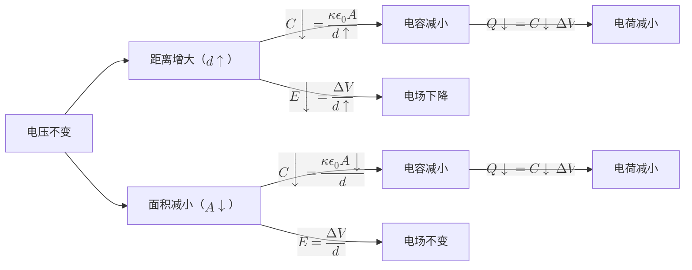
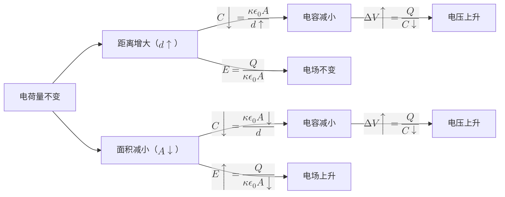

# 给电容充电

给电容充电是让电容两极板带等量异种电荷的过程。

将电容和电源并联，电容上聚集的电荷逐渐增多，直到电容两端的电压等于电源两端的电压。

# 给电容放电

给电容放电是中和电容两极板上电荷的过程。

将电容与电源断开，并和用电器并联，电容上聚集的电荷逐渐中和，直到电容两端的电压趋近 0。

# 电容 Electrical capacitance

同一个电容器，接通的电压不一样，其储存的电荷量也不一样。

但是，理想电容器电荷量和电压的比值总是一个常数：

$$\boxed{C = \frac{Q}{\Delta V}}$$

这就是电容，用来衡量**电容器储存电荷的能力**。

电容的国际单位是**法拉**（F），但是常用的单位是 $\mathrm{\mu F}$、$\mathrm{p F}$ 等。

> [!important] 细节：电容的正负性
> 求电容的时候，经常容易把电势差算反，导致电容算出来是负的。
> 设电容的两极板编号为 A 和 B，则电容的准确公式为：
> $$
> C = \frac{Q_A}{V_A - V_B}
> $$
> 即**A 板的电荷，除以 A 相对于 B 板的电势差**。

> [!note] 推导真空中电容的另一个公式
> 
> 假设两极板面积是 $A$，距离 $d$，极板电荷密度为 $\sigma$。
> 
> $$
> \begin {aligned}
> \Delta V &= Ed \\
> Q &= \sigma A \\
> E &= \frac{\sigma}{\epsilon_0} \\
> \implies C &= \frac{Q}{\Delta V} = \frac{\sigma A}{Ed} = \frac{\sigma A}{\frac{\sigma}{\epsilon_0}d} = \frac{\epsilon_0A}{d}
> \end {aligned}
> $$

# 电介质 dielectric

电介质是插入电容器两极板之间的绝缘物质。

> [!question] 电介质会对电容器产生什么影响呢？
> 电介质会发生**极化**，产生方向相反的电场，从而部分地抵消电容器两极板之间的电场。
> 假设电容器电荷量不变，$E_f = \frac{E_i}{\kappa}$，代入上述电容的原公式即可得到
> $$\boxed{C = \frac{\kappa \epsilon_0 A}{d}}$$
> 
> > [!important] 提醒
> > **电介质一定会使电容器的电容增大**。

# 电容器里的电场

$$
\boxed{E = \frac{\Delta V}{d}}
$$

此外，由 $\Delta V = Ed$、$\Delta V = \frac{Q}{C}$ 和 $C = \frac{\kappa\epsilon_0 A}{d}$，有

$$
\begin {aligned}
E &= \frac{\Delta V}{d}
= \frac{Q}{Cd}
= \frac{Q}{\left(\frac{\kappa\epsilon_0 A}{d}\right)d} \\
&= \boxed{ \frac{Q}{\kappa\epsilon_0 A} }
\end {aligned}
$$

---

# 电容器的动态分析

## 情况一：电容器的电压不变

当电容器连接到一个稳定的电源时，电容器的电压就会不变。

## 情况二：电容器的电荷量不变

当电容器与电源断开，不连接任何用电器时，电容器储存的电荷量不变。

---

# 电容器的能量

给电容器充电时，电源需要将电荷从电容器的一个极板移动到另一个极板。
在这个过程中，电源做正功，所以电容器获得了能量。计算过程如下：

$$
\begin{aligned}

dW &= V \cdot dQ \\

V &= \frac{Q}{C} \\

\implies dW &= \frac{Q \, dQ}{C} \\

\implies U_E = W &= \int_0^Q \frac{Q_1 \, dQ_1}{C} \\

&=\boxed{ \frac{Q^2}{2C} = \frac{C (\Delta V)^2}{2} = \frac{Q \Delta V}{2} }

\end{aligned}
$$
